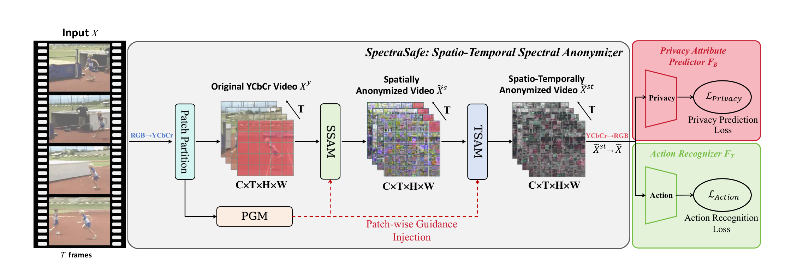
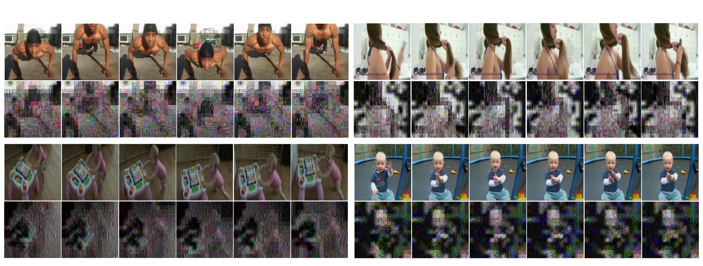
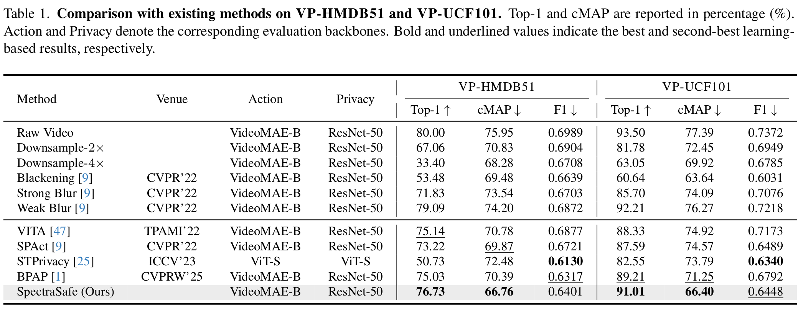

# SpectraSafe

Official implementation of **SpectraSafe: Spatio-Temporal Spectral Anonymization for Privacy-Preserving Action Recognition**, submitted to WACV 2027.

SpectraSafe anonymizes video in complementary spatial and temporal frequency domains. It learns coefficient-wise retention gates and noise scales, while a privacy guidance module focuses stronger modulation on potentially sensitive regions.

## Framework

<p align="center">
  
</p>

The input clip is converted to YCbCr, processed by the Spatial Spectral Anonymization Module (SSAM) and Temporal Spectral Anonymization Module (TSAM), and trained adversarially against action and privacy predictors.

## Qualitative Results

<p align="center">
  
</p>

Each example shows uniformly sampled raw frames above their anonymized counterparts. SpectraSafe suppresses fine-grained appearance while retaining action-relevant structure and motion.

## Main Results

<p align="center">
  
</p>

Higher Top-1 and lower cMAP/F1 are preferred. See the paper for cross-dataset experiments, ablations, and privacy-utility analysis.

## Installation

```bash
git clone https://github.com/s-yhao/SpectraSafe.git
cd SpectraSafe
pip install -r requirements.txt
```

The action evaluator additionally uses [OpenGVLab/VideoMAEv2](https://github.com/OpenGVLab/VideoMAEv2) at commit `29eab1e8a588d1b3ec0cdec7b03a86cca491b74b` and the official `vit_b_k710_dl_from_giant.pth` checkpoint.

## Data and Weights

Paths are supplied through environment variables; no machine-specific paths are stored in the repository.

```bash
export VIDEOMAEV2_ROOT=/path/to/VideoMAEv2
export VIDEOMAEV2_CHECKPOINT=/path/to/vit_b_k710_dl_from_giant.pth

# VP-UCF101
export VPUCF_ROOT=/path/to/UCF-101
export VPUCF_SPLITS=/path/to/ucfTrainTestlist
export VPUCF_PRIVACY_LABELS=/path/to/ucf101_privacy_attribute_label.pickle

# VP-HMDB51
export VPHMDB_ROOT=/path/to/hmdb51/videos
export VPHMDB_SPLITS=/path/to/testTrainMulti_7030_splits
export VPHMDB_PRIVACY_LABELS=/path/to/hmdb51_privacy_attribute_label.pickle
export VPHMDB_CLASS_INDEX=/path/to/classInd.txt
```

## Three-Stage Workflow

Run all commands from the repository root. Replace `vpucf.json` with `vphmdb.json` to use VP-HMDB51.

### 1. Initialization

Import the pretrained VideoMAE V2-B and ResNet-50 weights. This stage does not train an identity mapping.

```bash
python -m initialization.initialize --config configs/vpucf.json
```

### 2. Training

Train the anonymizer and adversarial predictors for 30 epochs, then freeze the anonymizer and train freshly initialized evaluators for 70 epochs.

```bash
python -m training.train --config configs/vpucf.json
```

### 3. Evaluation

```bash
python -m evaluation.evaluate \
  --config configs/vpucf.json \
  --checkpoint outputs/vpucf/checkpoints/benchmark_epoch070.pth \
  --phase benchmark
```

## Repository Structure

```text
configs/          Experiment configurations
initialization/   Pretrained-weight import
training/         Anonymizer and evaluator training
evaluation/       Checkpoint evaluation
fa_model.py       SpectraSafe anonymizer
data.py           VP-UCF101 and VP-HMDB51 data loaders
heads.py          Action and privacy evaluators
```

## Release Note

This is a clean, dependency-flattened implementation reconstructed from the final paper specification and audited historical experiments. It has not yet been numerically verified as a standalone release.

## Contact

For questions, please contact [sunyh_89@whut.edu.cn](mailto:sunyh_89@whut.edu.cn).
